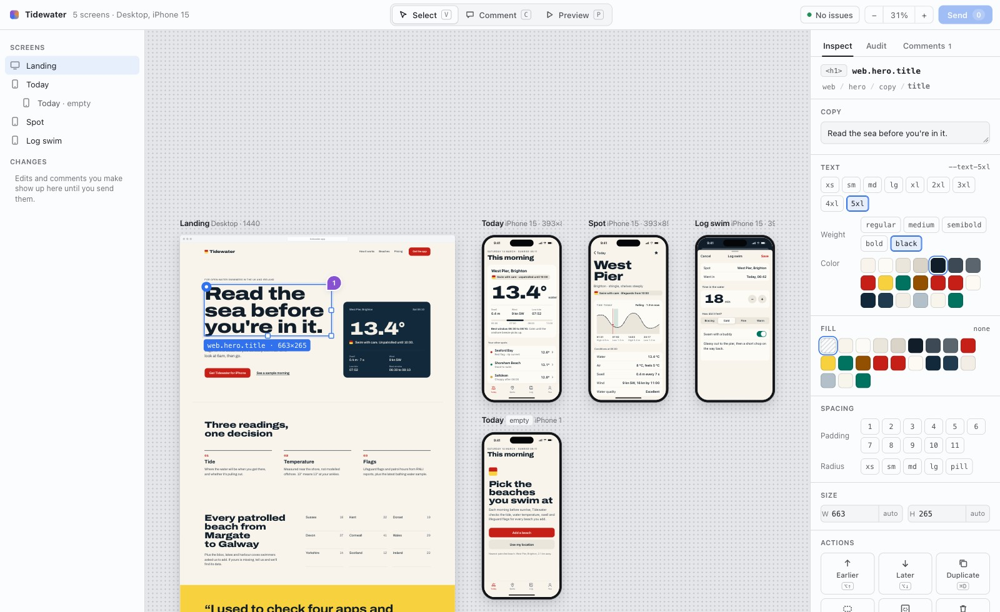

# Design Canvas

**Design every screen before you build it, on a canvas you can edit directly, then check the
build against it.**

Agents are good at code structure and weak at the part users actually see. The UI comes
last, gets built fast, looks generic, drifts from screen to screen, and can only be reviewed
once it's already code. Design Canvas moves the frontend to the front: the agent mocks every
screen as real HTML and CSS on one shared design system, the user changes those mocks
directly in a local canvas, the approved mocks become the spec the build has to match, and a
Test button runs the build and diffs it against them.



It's the frontend counterpart of [plan-graph](https://github.com/FenixSC2/plan-graph): plan-graph shows what every screen *does*; this
shows what every screen *looks like*, how it moves, and whether the build got it right. The two
will connect through the screen ids later.

## How it works

```
agent drafts tokens → components (with states) → screens (with widths and motion)
                ▲                                                │
                │                  user edits on the canvas, asks for variants, presses Send
                │                                                │
                └── canvas reloads ◄── agent applies & crafts ◄──┘   changeset: exact ops on data-ids
                                                                 │
                              build → Test build → compare → element-by-element diff on the canvas
```

1. **The agent grounds the design first**: a scene sentence (who, where, in what light),
   a color strategy, a type scale, motion timing. It all goes in `tokens.css`, the only file
   with raw values. Shared components and their hover, focus, pressed and disabled states go
   in `components.css`. It follows the impeccable skill's laws when that's installed.
2. **Screens are HTML fragments**, one per screen or state, in device frames: desktop browser,
   iPhone, Android, mobile web. Every element the user might point at has a stable `data-id`.
3. **The user edits directly**, and every edit is an exact op the agent receives:
   - Click to select (Esc walks up, Enter walks down, Tab steps through siblings); double-click
     to edit text; drag the grip to reorder or move into another container; resize with
     handles; duplicate, delete, or sketch a placeholder for the agent to build.
   - Swap type size, weight, color, fill, padding, gap or radius from the token scale.
   - **Widths**: web screens also show at 834px and 390px. Edit in a narrow frame and the edit
     lands in a media query for that width only.
   - **States**: switch any button or link to hover, focus, pressed or disabled to see that
     state, and edit it there; the edit becomes that state's rule.
   - **Components**: the catalog shows every shared component in every state. Edit `.btn` once
     and every button on every screen follows.
   - **Motion**: set an element's entrance (fade, rise, scale, slide, drop), speed, easing and
     stagger order, press feedback, and where it links with which transition (push, sheet,
     fade). Play it on the spot.
   - **Variants**: select anything and ask for alternatives ("calmer", "no card"). The agent
     draws three next to the screen; pick one or turn them all down.
   - Press C to pin a comment on any element; the agent's own questions appear as pins too.
   - Unsent work survives reloads.
4. **Play** (⇧P) opens the prototype player: the screens at real size, clicking through with
   their designed transitions and entrance motion, with ×4 slow motion and a reduced-motion
   switch.
5. **Send.** The CLI applies the mechanical ops (text, delete, move, duplicate, motion
   attributes, picked variants) to the source, keeping its formatting. The agent handles the
   ones that need judgment: it turns a resize into a layout decision rather than a fixed pixel
   height, puts a hover edit in the hover rule and a 390px edit in the 390px media query, folds
   a picked variant's CSS into the components, builds sketches, applies the note ("calmer
   overall") across screens, and answers every comment.
6. **Changes asked for in chat come back as proposals**: proposed screens beside the current
   ones, with what's added, changed or removed outlined. Accept all, some screens, or none;
   token and component changes are a separate checkbox.
7. **Test build.** When something is built, the Build tab asks the agent to run it in the
   simulator, on a device, or in the browser, then captures each screen and compares it with
   its mock. When the build carries the mock's ids as test ids, the comparison is per
   element: what's missing, what changed size, what drifted in style ("border-radius 14px →
   8px"), what looks different. Findings are numbered on both the mock and the build
   screenshot, and clicking one selects that element.

## What keeps the quality up

The default output should already be good, so the user isn't the one catching problems.

- **Tokens are the only choices.** The inspector offers the scale, not a free-form px field
  (raw values are possible, and flagged to the agent).
- **A live audit on the rendered page**, at every width: font sizes, colors, spacing and radii
  checked against the tokens; WCAG AA contrast against the actual background; 44pt tap targets
  on phones; transitions on layout properties or longer than 600ms; sideways scroll at
  breakpoints. It shows the scale *in use* across all screens, so drift is visible at a glance.
- **A static lint before the user sees anything**: missing tokens, raw values outside
  `tokens.css`, pressable components with no focus, hover or pressed state, animations with no
  reduced-motion fallback, `transition: all`, layout-property and overshooting animations, the
  banned patterns (side-stripe borders, gradient text, decorative glass, pure black and white),
  em dashes and lorem ipsum, images without alt, sketches nobody built.
- **A craft reference** the agent reads before drafting, which defers to impeccable when present.

## Native apps

Native screens are mocked in HTML that is structured like the native UI, so the agent can
rebuild it the same way every time:

- **Device frames** draw the status bar, Dynamic Island and home indicator. Screens pad with
  `var(--safe-top)` / `var(--safe-bottom)` and never fake system chrome.
- **Platform kits** (`kit/ios.css`, `kit/android.css`) provide HIG and Material metrics and
  take every color from the project's tokens. Class names map 1:1 to SwiftUI / Compose.
- **A motion vocabulary** (`kit/motion.css`) with token timing and a mapping to SwiftUI
  transitions, Compose animations and the web, so the build moves the way the mock does.
- **`data-component`** names the native component each element becomes; `canvas.mjs spec`
  prints the tree per screen, with motion and links. That is the handoff.
- **Testing on the real thing**: iOS screens map to deep links, `compare --simulator` opens each
  one in the booted simulator and diffs it, and any device screenshot works with `--image`.

## Design decisions

| Decision | Chosen | Instead of | Why |
|---|---|---|---|
| What a mock is | Real HTML/CSS fragments | A JSON scene graph, or generated images | The agent writes HTML at full craft; nothing is lost in translation; the mock is close to buildable. Images can't be edited or audited. |
| Where consistency comes from | One token file, checked at runtime | Style guidelines in the prompt | Rules in a prompt drift; a scale enforced by the inspector and the audit doesn't. |
| How style edits preview | One override stylesheet per frame | Inline styles | A narrow-width edit becomes a real media query, a hover edit a real `:hover` rule, a component edit a rule on every instance. |
| Previewing states | Each state rule gets an attribute twin | Simulated events | CSS can't fake `:hover` from script; `[data-dc-state~="hover"]` twins show any state on any element. |
| What the user's edits mean | Intent (ops), applied by the agent | The GUI rewriting source | A resize handle produces "436px"; good code needs "a taller card" expressed as layout. |
| Moving things | Reorder within, or move into, flow containers | Free x/y positioning | Real layouts are flow, flex and grid. Absolute nudges would produce mocks that can't be built. |
| Motion | Attributes with token timing | Hand-written keyframes per element | A small vocabulary is reviewable, consistent and maps onto every platform. |
| Chat changes | Proposals the user accepts in part | Edits made directly | The user sees the diff on the screens before it lands. |
| Build checking | Element-matched diff by id, pixel diff as fallback | Pixel diff only | One shifted heading makes everything below "different" in a pixel diff; matching by id reports what to fix. |
| Dependencies | None: Node's http server and WebSocket, headless Chrome over DevTools, a small PNG codec | Playwright, React/Vite | Starts instantly with no install. Worth revisiting if the GUI grows. |

## Try it

You need **Node 22 or newer**. `compare` and the Test build button also need Chrome,
Chromium, Edge or Brave (or set `CHROME_PATH`). There's nothing to install.

```bash
git clone https://github.com/FenixSC2/design-canvas.git
```

```bash
cd design-canvas && node scripts/canvas.mjs serve examples/tidewater/design
```

Open the URL it prints. The example is a sea-swim conditions product: a landing page at three
widths and five iOS screens (Today, its empty state, Spots, a spot, and a log-a-swim sheet),
with entrance motion, push and sheet transitions, and buttons with every state. Press K for
the component catalog and ⇧P to play the iOS flow.

To see the build comparison, compare the mock with the deliberately imperfect "built" landing
page in `examples/tidewater/build-web/` (a test fixture: same tokens, four planted drifts):

```bash
node scripts/canvas.mjs compare examples/tidewater/design
```

Make some edits, press Send, then play the agent:

```bash
node scripts/canvas.mjs show examples/tidewater/design
```

```bash
node scripts/canvas.mjs apply examples/tidewater/design
```

```bash
node scripts/canvas.mjs done examples/tidewater/design --summary "What I did beyond your edits"
```

Start a new design with `node scripts/canvas.mjs init design --device iphone`.

## Install as a skill

Clone it into your Claude Code skills folder, then ask Claude to design your app's screens.
`SKILL.md` drives the whole loop.

```bash
git clone https://github.com/FenixSC2/design-canvas.git ~/.claude/skills/design-canvas
```

## What's in it

| Path | What |
|---|---|
| `SKILL.md` | The agent's workflow: ground, draft, self-audit, review, apply, variants, proposals, test, build from mocks. |
| `references/format.md` | design.json, screen attributes, comments, variants, proposals, changeset ops, comparison reports. |
| `references/craft.md` | The quality bar: tokens, layout, states, motion, responsive. |
| `scripts/canvas.mjs` | CLI and local server. |
| `scripts/lib.mjs` | Offset-preserving HTML parser, lint, changeset formatting, mechanical apply, component catalog, spec. |
| `scripts/capture.mjs` | Headless Chrome over DevTools, simulator screenshots, PNG codec, pixel and element diffs. |
| `gui/app.js` | The canvas: frames, pan/zoom, selection, editing, inspector, audit, comments, variants, proposals, build. |
| `gui/states.js` | Forced interaction states. |
| `gui/player.js` | The prototype player. |
| `kit/` | Base reset and safe areas, iOS and Android kits, the motion vocabulary, canvas-only styles. |
| `templates/` | What `init` scaffolds. |
| `examples/tidewater/` | A complete example design, and a build fixture to compare against. |

## Not built yet

- **plan-graph link.** Screen ids match plan-graph surface ids, so each surface opens its
  mock and each mock shows the actions and outcomes plan-graph defined for it.
- **Interaction states per breakpoint.** A hover edit and a width edit combine in the op, but
  the inspector can't yet show a state and a narrow width at the same time in one frame.
- **Element-matched iOS comparison.** iOS builds compare per pixel region. Reading the
  accessibility tree (`accessibilityIdentifier`) through XCUITest would give iOS the same
  per-element report the web gets.

## Known limits

- Selection is by `data-id`. Elements without one can't be selected; the lint warns about
  interactive ones.
- Inline text editing flattens inline formatting inside the edited element.
- Moving across screens isn't supported (it's a different screen; the agent handles that
  from a comment).
- The audit checks computed styles, so a value produced by `calc()` that happens to equal a
  token passes, and a sum of a safe-area inset and a token is treated as on-scale.
- Running on a device is the agent's job (its build tools, your device); the canvas asks for
  it and shows the comparison afterwards, but it can't drive a physical phone itself.

## License

[MIT](LICENSE)
